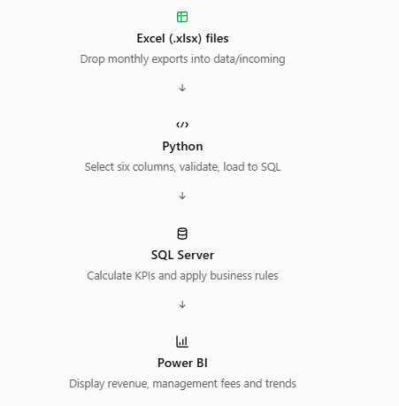

# Parking Revenue Analytics

**End-to-End Business Intelligence & Data Automation Project**

**Tech Stack:** SQL Server | Python | Power BI | Excel | Git & GitHub

## Project Overview

This project develops an end-to-end analytics solution for a
commercial parking operation.

The goal is to transform monthly Excel transaction exports into
reliable financial reporting, automated data processing, and
interactive Power BI dashboards.

### Business Questions

- How much revenue does the parking operation generate?
- How much revenue is attributable to hotel-classified parking?
- What revenue is eligible for management fee calculations?
- How much is owed in management fees?
- How does revenue change by day, month, and year?
- Which vehicle entry hours and weekdays generate the most revenue?

## Business Logic

### Hotel Parking Classification

A transaction is classified as hotel parking when:

1. Entry date and exit date are different.
2. Parking duration is at least 8 hours.

Article labels are excluded because they are not reliable identifiers.

### Management Fee

- Eligible Revenue = Total Revenue - Hotel Revenue
- Annual Threshold = $300,000
- Management Fee = 5% x MAX(0, Annual Eligible Revenue - $300,000)

The threshold applies to eligible revenue within each calendar year.

## Planned Architecture

The following diagram illustrates the planned end-to-end
data pipeline, from monthly Excel exports to interactive
Power BI dashboards.

## Local SQL Server Setup

- Database engine: SQL Server 2025 Standard Developer
- Instance: MSSQLSERVER (default instance)
- SSMS server name: localhost
- Authentication: Windows Authentication
